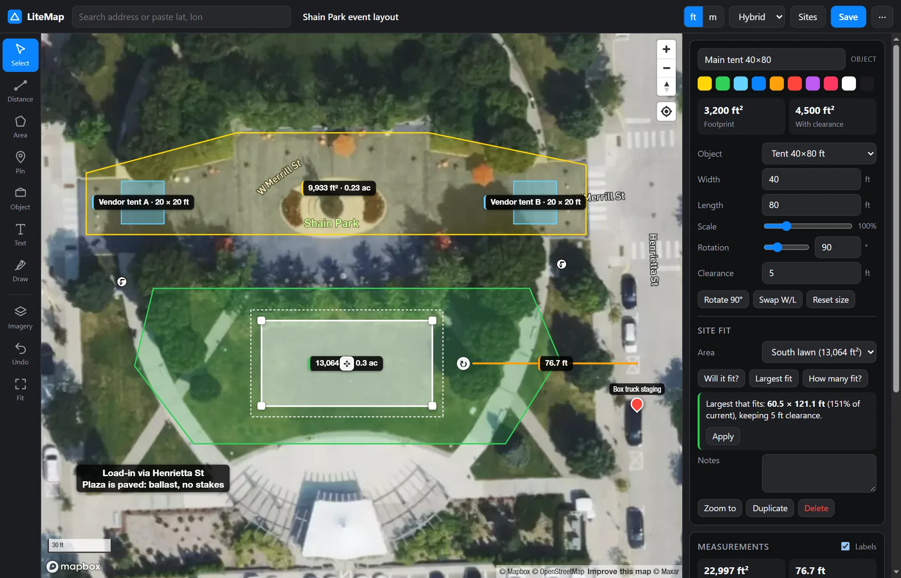
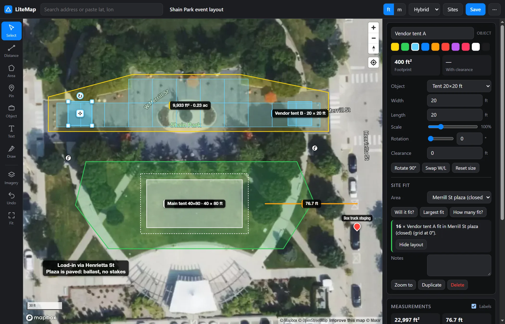
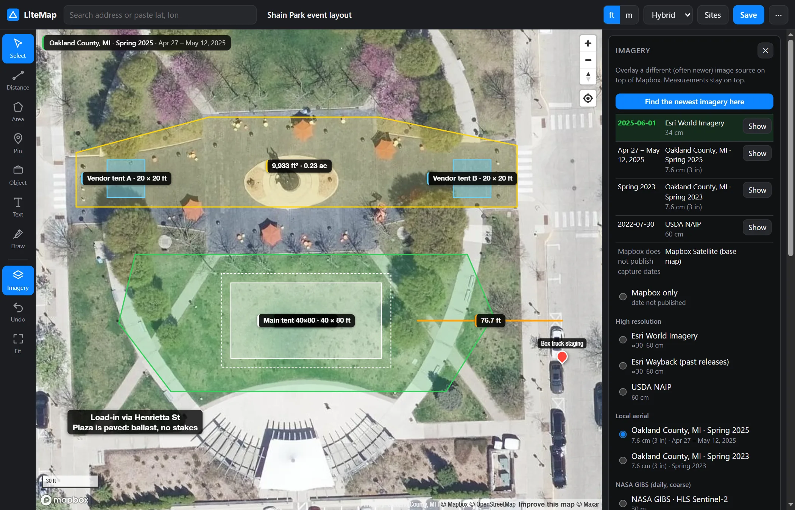
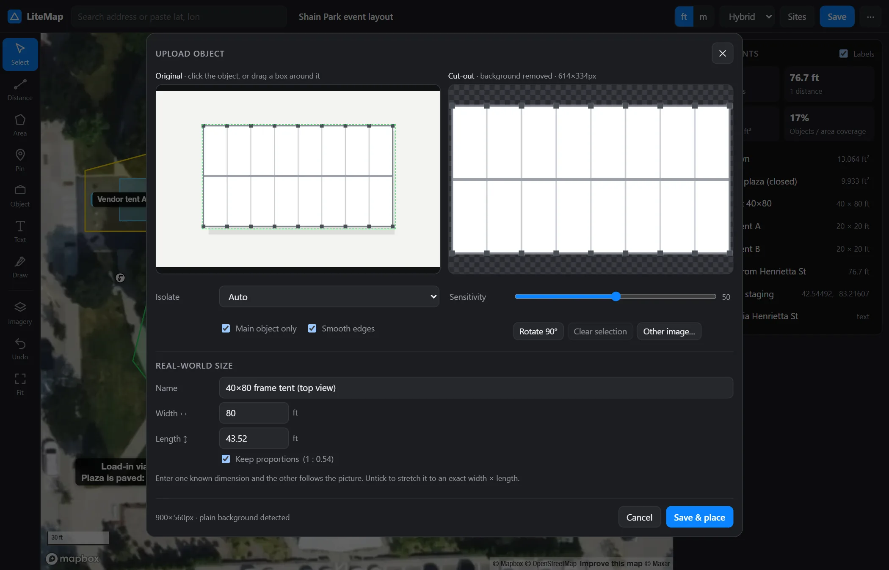
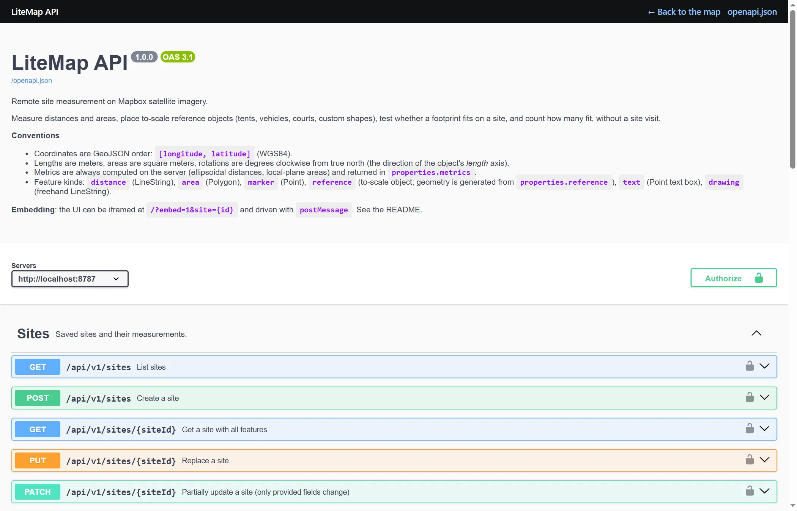

<div align="center">


# LiteMap

**Measure any site from satellite imagery, without a site visit.**

Distances, areas, to-scale tents and vehicles, *will it fit?* and *how many fit?*, all in a self-hosted web app<br>with an OpenAPI 3.1 REST API and an embeddable map. Zero dependencies, no build step.

[](https://github.com/248Tech/litemap/releases)
[](LICENSE)
[](https://nodejs.org)
[](#rest-api)
[](package.json)

[**Live demo**](https://248tech.github.io/litemap/app/) · [**Website**](https://248tech.github.io/litemap/) · [**Download**](https://github.com/248Tech/litemap/releases/latest) · [Quick start](#quick-start) · [Use cases](#use-cases) · [API](#rest-api) · [Embedding](#embedding)



</div>

---

## Why LiteMap

Quoting a job usually means driving out with a measuring wheel. LiteMap lets you do the first pass at your desk. Look the site up, outline the usable ground, drop the actual equipment on it at true scale, and get an answer such as "a 40×80 with 5 ft clearance fits, and the largest that fits is 60×120". Then share a link, export GeoJSON or CSV, or let your CRM pull the numbers through the API.

- **Accurate math.** Vincenty ellipsoidal distances (under 1 mm error) and ellipsoid-scaled areas. One geodesy module runs in both the browser and the API, so their numbers always match.
- **The newest imagery you can get.** Overlay Esri, Esri Wayback, USDA NAIP, 3-inch county aerials, NASA GIBS, or the SkyFi commercial archive, and see the **capture date** of each at the map center.
- **Your own objects.** Upload a photo or drawing. LiteMap cuts the object out in the browser with an on-device AI model, then scales it to its real size.
- **Built to integrate.** A documented REST API, a Swagger UI, a `postMessage` iframe API, and API-key auth.
- **Tiny and self-hosted.** About 330 KB of readable, unminified source, Node ≥ 22.9, and no `npm install`. Your data stays on your server as a JSON file.

## Features

| | |
| --- | --- |
| **Measure** | Distances with per-segment and running totals. Areas in ft² and acres or m² and ha, with perimeter. Vertex snapping, Alt-click to delete a vertex, and full undo. |
| **To-scale objects** | Frame and structure tents from 10×10 to 100×200 ft, stages, dance floors, cars, trucks, 53′ trailers, containers, lifts, dumpsters, generators, parking stalls, restrooms, tables, sports courts and fields, plus custom rectangles and circles. Set the **clearance** for stakes, guy lines and egress. |
| **Top-down skins** | Every catalog object is drawn as a to-scale top-down model: tent roofs with bays and legs, vehicles, containers, tables with chairs, and courts with regulation lines. Skins follow rotation and resizing and take the object's colour. Toggle **Skins** off for flat footprints. The catalog carries 90 stock tents: frame and canopy tents from 10×10 to 40×160 ft, clearspans from 50×50 to 120×300 ft, and metric clearspans from 10×10 to 40×100 m. |
| **3D tent builder** | **Build a tent…** (Object tool, Tents section) designs a tent in an orbitable 3D preview: any width and length, pyramid, hip or gable roof, leg and peak heights, bay spacing, sidewalls per side (open, solid, windows or clear) and fabric colour, with footprint, roof fabric, sidewall length, legs, ballast blocks and interior volume worked out as you go. Placed tents reopen in the builder from the inspector. Switch on **3D** to stand every tent up on the tilted map. |
| **Site fit** | **Will it fit?** finds the position and rotation with the most margin. **Largest fit** finds the biggest size that still fits. **How many fit?** packs a grid aligned to the area's edges and draws the layout. |
| **Upload objects** | Drop, paste, or choose an image. LiteMap cuts the object out (AI for photos, colour keying for plain backgrounds) and crops it. Click an object to choose it, or drag a box. Set a known width or length, or stretch the image to exact dimensions. |
| **Imagery** | Find the newest imagery at the map center. Sources include Esri World Imagery and Wayback, NAIP, county 3-inch aerials, NASA GIBS (HLS Sentinel-2 and Landsat, VIIRS), SkyFi archive search, and custom XYZ or ArcGIS layers. **Enhance** sharpens tiles or upscales them with AI. |
| **Annotate** | Pins, multi-line text boxes, freehand drawing, colours, notes, and labels you can switch off globally or per object. **Show measurements** pins side lengths on any shape or object. |
| **Share and export** | Saved sites with a link, GeoJSON, CSV, text summary, a static satellite snapshot with your measurements drawn on it, and embed code. |
| **Integrate** | OpenAPI 3.1 REST API, Swagger UI at `/docs`, an iframe embed mode with a read-only option, a `postMessage` API, API keys, and CORS. |

## Screenshots

<table>
  <tr>
    <td width="50%"><br><sub><b>How many fit?</b> Sixteen 20×20 tents tile the closed plaza.</sub></td>
    <td width="50%"><br><sub><b>Newest imagery.</b> Every source ranked by its real capture date; here a 3-inch county flight is overlaid.</sub></td>
  </tr>
  <tr>
    <td width="50%"><br><sub><b>Upload object.</b> Cut out, cropped, and sized to its real dimensions.</sub></td>
    <td width="50%"><br><sub><b>REST API.</b> OpenAPI 3.1 with interactive docs at <code>/docs</code>.</sub></td>
  </tr>
</table>

## Use cases

- **Tent and event rentals:** check that a tent, its clearance and its stakes fit before quoting, find the biggest tent a yard takes, and lay out vendor rows.
- **Event planning and venues:** lay out stages, bars, restrooms, generators and load-in routes, and count tables or booths for an area.
- **Construction and site logistics:** plan where containers, dumpsters, lifts and trailers go, measure laydown yards and truck access.
- **Landscaping, fencing, paving and roofing:** measure square footage and linear feet for quotes, and compare before and after with dated imagery.
- **Real estate and property management:** measure lots, parking capacity and usable outdoor space.
- **Pools and outdoor builds:** check fit and setbacks, and confirm what's on the ground with the newest imagery.
- **Field sales and CRM:** create a site from an address via the API, measure it, and store the numbers on the deal.

## Quick start

**Requirements:** [Node.js](https://nodejs.org) 22.9 or newer and a free [Mapbox access token](https://account.mapbox.com/access-tokens/) (a public `pk.…` token).

```bash
git clone https://github.com/248Tech/litemap.git
cd litemap
cp .env.example .env      # then put your Mapbox token in .env: MAPBOX_TOKEN=pk.…
npm start                 # → http://localhost:8787
```

There's nothing to install: no dependencies, no build. Run `npm test` for the geodesy and API test suite.

Or download the [latest release](https://github.com/248Tech/litemap/releases/latest), unzip it, and run the same `cp` and `npm start` steps.

| URL | What |
| --- | --- |
| `/` | Mapping app |
| `/?site={id}` | Open a saved site |
| `/?embed=1&site={id}` | Embeddable view (add `&readonly=1` for view-only) |
| `/docs` | Interactive API docs (Swagger UI) |
| `/openapi.json` | OpenAPI 3.1 spec for client code generation |
| `/examples/embed.html` | Live `postMessage` integration demo |

### Run with Docker

```bash
docker build -t litemap .
docker run -d -p 8787:8787 -e MAPBOX_TOKEN=pk.your_token -v litemap-data:/data litemap
```

### Deploy

LiteMap is a single Node process with a data folder, so any VM, container host or PaaS works (Render, Fly.io, Railway, a VPS with systemd or pm2). Put it behind HTTPS and set:

- `PUBLIC_URL` so the links returned by the API are correct;
- `LITEMAP_API_KEY` to require a key on the API;
- `CORS_ORIGINS` to limit which sites can call it.

Keep `DATA_DIR` on persistent storage.

### Mapbox token

The browser gets the token from `GET /api/v1/map/config` and uses it for satellite tiles and search. The server uses the same token for `/geocode`, `/snapshot` and site address lookups. If you add **URL restrictions** to the token, include every origin that serves LiteMap, and set `MAPBOX_SERVER_TOKEN` to an unrestricted token: server-side calls send no browser Referer, so a URL-restricted token can fail for them.

---

## Using the app

| Tool | Key | Notes |
| --- | --- | --- |
| Select | `V` | Click shapes to edit. Drag vertices, drag a midpoint to insert a vertex, and **Alt-click** a vertex to delete it. |
| Distance | `D` | Click points. Click the last point or press **Enter** to finish. Live segment and running totals are shown. |
| Area | `A` | Click points, then click the first point or press **Enter** to close. Shows area (ft² and acres, or m² and ha) and perimeter. |
| Pin | `P` | Named marker with editable lat/lon. |
| Object | `R` | Place a to-scale object from the catalog. A ghost preview follows the cursor. |
| Upload object | `U` | Turn a photo or drawing into your own to-scale object. You can also drop an image anywhere on the map. |
| Text | `T` | Click to place a text box, then type in the panel. Supports multiple lines, size, colour, and an optional dark background. Drag the box to move it. |
| Draw | `B` | Freehand pen with colour and width. The map doesn't pan while drawing, and strokes are simplified on save. |
| Imagery | `I` / `E` | `I` flips between the overlay and Mapbox; `E` toggles Enhance. |
| Undo / Fit all | `Ctrl+Z` / `F` | Full edit history; zoom to everything. |

New points snap to existing vertices within 10 px. Hold **Alt** to place a point without snapping.

**Reference objects** resize from the corner handles (**Shift** keeps proportions) and rotate with the ↻ handle (**Shift** snaps to 15°). You can also type exact width, length, scale %, rotation and **clearance**.

**Site fit** (select an object, with an area drawn):

- **Will it fit?** places the object, plus its clearance, where it has the most margin and reports the tightest gap.
- **Largest fit** finds the biggest uniform scale that still fits, for example "the biggest tent this lot takes is 60×121 ft".
- **How many fit?** grid-packs copies aligned to the area's edges and draws the layout, for parking capacity, table counts or tent rows.

### Uploaded objects

Drop, paste (`Ctrl+V`) or choose an image. Top-down views work best: plan drawings, drone or aerial shots, product renders. LiteMap isolates and crops the object **in your browser**:

- **Auto** picks the method. Transparent images keep their alpha. Plain or uniform backgrounds are flood-filled away from the edges. Photos go through an on-device salient-object model ([U²-Net `u2netp`](https://github.com/xuebinqin/U-2-Net), 4.5 MB). It makes a normal and a mirrored pass on several CPU threads, then a guided filter snaps the mask to the real edges. A photo takes about 5–15 s the first time and about 1 s for later tweaks, with live progress on screen.
- **Click the object** to choose it; if the AI overlooked it, LiteMap looks again zoomed in around the click. Or **drag a box** around it. Fine-tune with **Sensitivity**, **Main object only**, **Smooth edges**, or **Crop only**.
- **Rotate 90°** sets the front: the image's top edge faces the object's rotation, so 0° is north.
- Enter one real dimension and **Keep proportions** fills in the other, or untick it to stretch the image to an exact width × length.

Saved objects appear under **My objects** in the catalog and can be reused on any site. On the map the picture is pinned to the footprint's corners, so it moves, rotates and scales with the handles, and works with all the site-fit tools.

### 3D Modeler

Open **/modeler** (menu **⋯ → 3D Modeler**, or the **3D Modeler** button in the Tents list) for a full-page 3D workspace. It has the same controls as the tent builder: size, roof, leg and peak heights, bays, sidewalls and fabric. It adds a **Ballast** switch (a steel plate with two concrete blocks at every leg), the quantities for a quote, and an export pipeline:

1. **Save to LiteMap** stores the model as an editable recipe in your library (`data/models.json`).
2. **Place on map** opens the map with the model armed for placement. It is an ordinary tent on the site (size, `reference.tent` and colour), so it stays to scale, works with *Will it fit?* and *How many fit?*, and stands up in 3D when the **3D** switch is on. Saved models also appear under **My models** in the catalog.
3. **Download .glb** writes a glTF 2.0 binary for Blender, three.js, Windows 3D Viewer and similar tools (metres, +Y up, ground at y = 0, footprint centred, front toward +Z; clear walls and window panes are blended). The recipe is embedded in the file, so **Import…** can bring it back for editing. **Download model file** gives the same recipe as `.litemap-model.json`, which is also what you POST to `/api/v1/models`.

Ballast is a map-wide display switch (**Ballast** next to **Skins**); a model's own ballast setting applies to its .glb and to the Modeler preview.

Try it online, without installing anything: **[248tech.github.io/litemap/app/modeler.html](https://248tech.github.io/litemap/app/modeler.html)**.

### Live demo and website

The website and its live demo are built by `node scripts/build-pages.mjs` into `_site/` and deployed by `.github/workflows/pages.yml`. The demo is the real app with `public/js/demo-api.js` answering the REST API in the browser (sites and models live in the visitor's localStorage; uploads, imagery dates and snapshots need a server). Set a **public** Mapbox token as the `MAPBOX_TOKEN` repository secret, ideally URL-restricted to your Pages domain. To preview locally: `node scripts/build-pages.mjs --env` (reads `.env`), then serve `_site/`.

### Your own catalog

Put your own objects in `data/catalog.json` (for example your company's tent line) and restart. They show first in the object list and in the builder's stock sizes, and the API accepts them. Sizes are in metres. Ids that start with `tent-` get tent skins, the 3D view and the builder, and `tent` sets that tent's roof, heights, bays and walls:

```json
{ "items": [
  { "id": "tent-acme-40x60-hip", "category": "Our tents", "name": "40×60 ft hip clearspan",
    "width": 12.192, "length": 18.288, "tent": { "roof": "hip", "eave": 2.44, "walls": { "back": "solid" } } }
] }
```

`data/` is git-ignored, so the list stays private.

### Imagery: finding the newest picture of a site

Imagery providers update on different schedules, so one map can show a pool still being dug while another shows it finished and filled. The **Imagery** panel overlays other sources on top of Mapbox, and **Find the newest imagery here** ranks them by actual capture date at the map center (also available as `GET /api/v1/imagery/dates?lon=&lat=`).

| Source | Resolution | How current | Notes |
| --- | --- | --- | --- |
| **Esri World Imagery** | ≈30–60 cm | Several updates a year; the date is looked up per location | Often the newest free high-res source |
| **Esri Wayback** | ≈30–60 cm | Every Esri release since 2014 | What a site looked like before |
| **USDA NAIP** | 60 cm | Every 2–3 years | Contiguous US |
| **County aerials** (e.g. Oakland County, MI) | 3 in (7.6 cm) | Annual or biennial spring flights | Sharpest by far; shown only where the county has coverage |
| **NASA GIBS** (HLS Sentinel-2 and Landsat, VIIRS) | 30 m / 375 m | Every few days | Coarse; good for clearing, large builds, flooding |
| **SkyFi archive** (optional) | 30–50 cm | Commercial captures | Free search with date, cloud cover and price estimate; you order in SkyFi |
| **Custom** | any | | Any XYZ template or ArcGIS `ImageServer`/`MapServer` URL |

**Enhance** (`E`) has two modes for zooming past the native resolution:

- **Sharpen** uses only real pixels: de-blocking, Lanczos-3 resampling and an unsharp mask. It's safe to measure on.
- **AI super-resolution (beta)** runs [Real-ESRGAN](https://github.com/xinntao/Real-ESRGAN) in the browser. It makes edges crisper but **can invent plausible detail**, so use it to read a scene, not to take measurements.

Add your own county service for everyone by appending an entry to `public/js/imagery.js`. Enable SkyFi by adding `SKYFI_API_KEY=` to `.env`.

> **Licensing:** Esri World Imagery and Wayback are free to view, but Esri's terms require an ArcGIS account for production use outside ArcGIS. NAIP and NASA GIBS are public domain. County imagery follows each county's open-data terms.

### Accuracy

The math is effectively exact. Distances use Vincenty's formula; areas use an ellipsoid-scaled local plane, with authalic-sphere excess for very large shapes. In practice **the imagery is the limit**: satellite imagery is typically within about 1–3 m horizontally, can be a year or more old, and shows some building lean. Treat results as **quote-grade, not survey-grade**, and verify critical clearances (property lines, overhead lines, slope) before installing.

---

## REST API

Every endpoint is under `/api/v1`. The full schema is at `/openapi.json` and the interactive docs are at `/docs`.

- Coordinates are GeoJSON `[lon, lat]`.
- Units are meters and m².
- Rotation is degrees clockwise from north along the object's length axis.

If `LITEMAP_API_KEY` is set, send `X-API-Key: <key>` or `Authorization: Bearer <key>`.

| Method & path | Purpose |
| --- | --- |
| `GET /health` | Status and configuration |
| `GET /map/config` | Public Mapbox token and style IDs |
| `GET /geocode?q=` | Address search (Mapbox Geocoding v6) |
| `GET /reference-objects` | Object catalog |
| `GET/POST /objects` | List or upload your own objects (PNG, WebP or JPEG up to 8 MB; `?name=&width=&length=` in meters) |
| `GET/PATCH/DELETE /objects/{id}` · `GET /objects/{id}/image` | Object metadata, and the public, immutable image |
| `GET/POST /models` · `GET/PATCH/DELETE /models/{id}` | Saved 3D tent models from the [3D Modeler](#3d-modeler) (the body is the model fields or an exported `litemap-model` file) |
| `GET /models/{id}/glb` | The model as a glTF binary (`model/gltf-binary`) |
| `GET /imagery/sources` · `GET /imagery/dates` | Imagery catalog · capture dates at a point, newest first |
| `POST /imagery/skyfi/archives` | Search SkyFi's archive for an area (no ordering) |
| `POST /measure` | Metrics for any Geometry, Feature or FeatureCollection |
| `POST /footprint` | Generate a to-scale object polygon |
| `POST /fit` | Will it fit? (`findLargest: true` also returns the maximum size) |
| `POST /pack` | How many fit? |
| `GET/POST /sites` · `GET/PUT/PATCH/DELETE /sites/{id}` | Sites (create from an `address`; free-form `metadata` and `tags`) |
| `GET/POST /sites/{id}/features` · `GET/PUT/DELETE /sites/{id}/features/{fid}` | Measurements |
| `GET /sites/{id}/geojson` · `GET /sites/{id}/snapshot` | GeoJSON download · static satellite image URL with measurements drawn |

```bash
# Create a site from an address, with your own CRM id
curl -X POST localhost:8787/api/v1/sites -H 'Content-Type: application/json' -d '{
  "name": "Smith wedding", "address": "1200 W 55th St, Kansas City, MO",
  "metadata": { "quoteId": "Q-1042" }
}'

# Will a 40×80 tent with 5 ft (1.524 m) clearance fit in a drawn area? What's the biggest that fits?
curl -X POST localhost:8787/api/v1/fit -H 'Content-Type: application/json' -d '{
  "siteId": "SITE_ID", "featureId": "AREA_ID",
  "templateId": "tent-40x80", "clearance": 1.524, "findLargest": true
}'

# Parking capacity of a lot
curl -X POST localhost:8787/api/v1/pack -H 'Content-Type: application/json' -d '{
  "polygon": { "type": "Polygon", "coordinates": [[[-94.581,39.101],[-94.579,39.101],[-94.579,39.100],[-94.581,39.100]]] },
  "templateId": "parking-stall"
}'

# Upload a cut-out (12.192 m = 40 ft wide) and place it on a site
curl -X POST 'localhost:8787/api/v1/objects?name=Frame%20tent&width=12.192' -H 'Content-Type: image/png' --data-binary @tent.png
curl -X POST localhost:8787/api/v1/sites/SITE_ID/features -H 'Content-Type: application/json' -d '{
  "type": "Feature",
  "properties": { "reference": { "objectId": "OBJECT_ID", "width": 12.192, "length": 24.384, "center": [-94.58, 39.1], "rotation": 30 } }
}'
```

Generate a typed client with any OpenAPI generator:

```bash
npx @openapitools/openapi-generator-cli generate -i http://localhost:8787/openapi.json -g typescript-fetch -o client
```

## Embedding

```html
<iframe src="https://maps.example.com/?embed=1&site=SITE_ID&origin=https://crm.example.com"
        width="100%" height="600" style="border:0"></iframe>
```

Passing `origin=` pins both the `postMessage` target and the accepted sender. See [`public/examples/embed.html`](public/examples/embed.html) for a working demo.

| Send to the iframe | Payload |
| --- | --- |
| `litemap:loadSite` | `{ siteId }` |
| `litemap:setFeatures` | `{ features: FeatureCollection, zoom? }` |
| `litemap:addFeature` | `{ feature, select?, zoom? }` |
| `litemap:removeFeature` / `litemap:selectFeature` | `{ featureId }` |
| `litemap:setView` | `{ center: [lon,lat], meters? \| zoom?, bearing?, mapType? }` |
| `litemap:fitAll`, `litemap:save` | (none) |
| `litemap:setUnits` | `{ units: 'imperial' \| 'metric' }` |
| `litemap:setTool` | `{ tool: 'select' \| 'distance' \| 'area' \| 'marker' \| 'reference' }` |
| `litemap:getState` | `{ requestId? }`, which replies with `litemap:state` |

| Received from the iframe | Payload |
| --- | --- |
| `litemap:ready` | `{ siteId, readonly }` |
| `litemap:change` | `{ siteId, dirty, features, totals }` (debounced) |
| `litemap:select` | `{ featureId }` |
| `litemap:saved` | `{ siteId, site }` |
| `litemap:state` | `{ requestId, site, view, features, totals }` |
| `litemap:error` | `{ requestId, message }` |

## Configuration

| Variable | Default | Description |
| --- | --- | --- |
| `MAPBOX_TOKEN` | | Public Mapbox token (required) |
| `MAPBOX_SERVER_TOKEN` | `MAPBOX_TOKEN` | Token for server-side geocoding and static images |
| `LITEMAP_AUTO_ADDRESS` | `1` | Look up each site's street address from its location on save (Mapbox reverse geocoding). `0` turns it off; typed addresses always work |
| `SKYFI_API_KEY` | | Enables SkyFi archive search |
| `PORT` / `HOST` | `8787` / `0.0.0.0` | Listen address |
| `PUBLIC_URL` | from the request | Base URL for links in API responses |
| `DATA_DIR` | `./data` | Sites (`sites.json`) and uploaded objects |
| `LITEMAP_API_KEY(S)` | | Comma-separated API keys; when set, the API requires one |
| `CORS_ORIGINS` | `*` | Comma-separated origins allowed to call the API |

## Project layout

```
server/            zero-dependency Node HTTP server
  app.js           routing, handlers, static files
  features.js      validation and normalization of sites and features
  objects.js       uploaded-object library
  models.js        3D model library (3D Modeler)
  imagery.js       capture-date lookups, SkyFi client
  mapbox.js        geocoding and static images
  openapi.js       OpenAPI 3.1 document
  store.js         atomic JSON-file storage
public/            the web app (plain ES modules, no build)
  js/app.js        UI on Mapbox GL JS
  js/geo.js        geodesy, fit and pack (shared with the server)
  js/references.js object catalog (shared with the server)
  js/modelfile.js  litemap-model document and .glb export (shared with the server)
  js/modeler.js    3D Modeler page (modeler.html)
  js/imagery.js    imagery catalog (shared with the server)
  js/*-worker.js   tile enhancement and object cut-out (Web Workers)
  models/          ONNX weights (Real-ESRGAN, U²-Net u2netp)
docs/              project website (GitHub Pages)
test/              node:test suites
```

Storage is a single JSON file written atomically, which is fine for thousands of sites. To scale beyond that, swap `server/store.js` for SQLite or Postgres; its interface is five methods.

## Security and privacy

- The Mapbox token you configure is a **public** browser token by design. Restrict it to your domains in your Mapbox account.
- Set `LITEMAP_API_KEY` before exposing the API to the internet, and set `CORS_ORIGINS`.
- Uploaded object images are served from unguessable, public URLs so that maps and embeds can show them. Listing, editing and deleting objects require the API key.
- Object cut-out and AI enhancement run entirely in the browser. Images are only sent to your server when you save.

See [SECURITY.md](SECURITY.md) to report a vulnerability.

## Contributing

Issues and pull requests are welcome; see [CONTRIBUTING.md](CONTRIBUTING.md). Please run `npm test` before submitting.

## License

[MIT](LICENSE) © 2026 248Tech. Bundled model weights keep their own licenses (Apache-2.0 and BSD-3-Clause); see [THIRD_PARTY_NOTICES.md](THIRD_PARTY_NOTICES.md). Map data and imagery are © their providers and subject to their terms.
